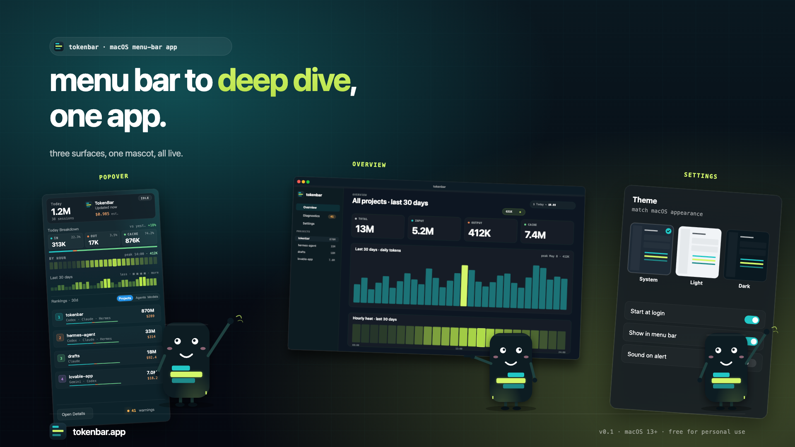
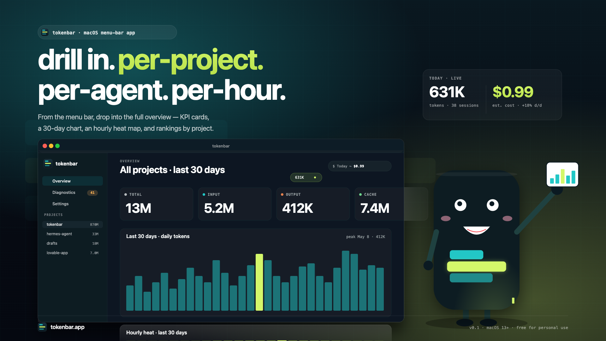
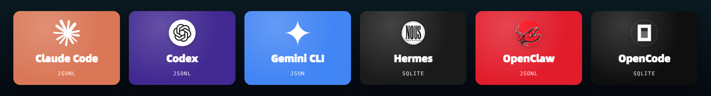
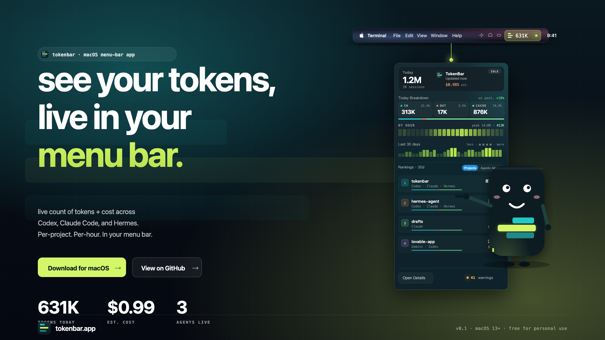
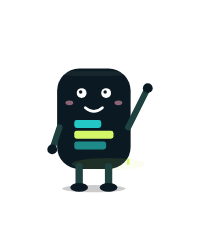

<div align="center">

# TokenBar 📊

### See your AI token spend, live.
### 把每一笔 AI 编码 token，钉在你的菜单栏上。

A macOS menu-bar app that aggregates **Claude Code · Codex · Gemini CLI · Hermes · OpenClaw · OpenCode · Warp · Pi · oh-my-pi · Qoder · Kiro · Kimi Code · Grok CLI · Devin · DeepSeek Harness · Antigravity · Cursor** usage.
Live tokens, reported and estimated cost — by project, by agent, by model. **Local-first · No signup · No telemetry.** Optional Cursor account sync is off by default and requires explicit setup.

[](https://www.apple.com/macos/)
[](https://www.swift.org/)
[](https://developer.apple.com/xcode/swiftui/)
[](Resources/Info.plist)
[](https://github.com/Bububuger/tokenbar/actions/workflows/ci.yml)
[](LICENSE)

Source tree: **1.9.0 release candidate**. The bundled update manifest still targets 1.8.12; see [release notes](docs/releases/1.9.0.md) for publication status.

[**Install**](#-install--安装) ·
[**Features**](#-features--功能) ·
[**Sources**](#-supported-sources--已支持的数据源) ·
[**CLI**](#-cli--tbar) ·
[**Wrapped Report**](#-tokenbar-report-skill--年度回顾报告) ·
[**Why**](#-why-tokenbar--为什么做-tokenbar) ·
[**Build**](#%EF%B8%8F-build-from-source--从源码构建)

<br />



</div>

---

## ✨ Why TokenBar / 为什么做 TokenBar

You're paying for Claude, Codex, Gemini and a long tail of coding agents that all silently burn tokens. The bills land monthly; the answers don't. **TokenBar reads local logs by default** and gives you the one number you actually want — *what does today look like, by project, by model, in real money*. Cursor account usage is available as a separate, explicit opt-in sync.

> **中文**：你同时在用 Claude、Codex、Gemini 和一堆编码 Agent，每家都在悄悄烧 token，账单按月寄来、明细却拼不起来。TokenBar 默认直接读取这些 Agent **已经写在本地磁盘上**的日志，把“今天花了多少、按项目 / 按模型 / 折成多少钱”钉在菜单栏上；Cursor 账号用量是独立的显式可选同步。

<br />

## ⚡ Features / 功能

|   | Feature | What it does |
|---|---|---|
| 🟩 | **Menu-bar first** | A cascade-fill glyph that grows with today's tokens vs. your 30-day peak. A glance, not a tab. <br/> *菜单栏图标会随今日 token 占 30 天峰值的比例「水位上涨」，一眼即看，不必再切窗口。* |
| 💰 | **Reported + estimated cost** | Source-reported amounts take priority, including zero; otherwise use token-rate estimates with app pricing overrides. These are usage-ledger totals, not reconciled invoices. <br/> *优先保留来源实际报告的金额（含零值），缺失时按 token 单价估算；App 支持价格覆盖，不代表账单核对结果。* |
| 🔒 | **Local-first data** | Local sources stay on this Mac in SQLite; there is no telemetry or cloud sync. Optional Cursor account sync is off by default, stores its credential in Keychain, and contacts only Cursor after you explicitly enable it. The GitHub release check remains separately opt-out; the Plugins gallery fetches a remote registry and selected plugin files. <br/> *本地数据源只落本机 SQLite，无遥测、无云同步。Cursor 账号同步默认关闭，需显式开启，凭证存入钥匙串，且仅请求 Cursor；GitHub 版本检查可单独关闭；插件页会请求远端目录并下载所选插件。* |
| 🔎 | **Drill into the source** | Click the popover, slice by project · agent · model · session · prompt. <br/> *点开 Popover 即可按 项目 · Agent · 模型 · 会话 · Prompt 任意切片下钻。* |
| 🎴 | **`tokenbar-report` skill** | Wrapped-style yearly recap across **3 anime power-system personas** (BLEACH · Hunter × Hunter · JOJO) — pick a card, get a different lens on the same dataset; lens-isolation gate keeps the three reports < 30% overlap. <br/> *年度回顾以三个动漫能力体系人格切镜头（死神 / 猎人 / JOJO），抽卡随机切换；强制视角隔离 < 30% 重合度。* |
| 🛠 | **`tbar` CLI** | Seventeen commands: fifteen read queries, `rebuild` for full reindexing, and `prompt` for saved templates. <br/> *十七条命令，覆盖用量查询、Skills / MCP / 插件清单、历史重建与保存的模板。* |
| 📚 | **Library + plugins** | Browse local skills, MCP configuration, Claude plugins, and CLI tools. Add usage sources from the community plugin gallery. <br/> *Library 汇总本地 Skills、MCP 配置、Claude 插件和 CLI 工具；社区插件可扩展用量数据源。* |

<p align="center">
  
  <br/>
  <sub><i>Drill in — per project · per agent · per hour. The same number, six lenses.</i></sub>
</p>

<br />

## 🔌 Supported Sources / 已支持的数据源

TokenBar ships with **seventeen** built-in engines. Sixteen discover local usage files at their default paths when present. Cursor also preserves local human prompts for project history; account-wide usage and available reported costs require the optional Dashboard sync in Settings.

The newest local sources are (some sources also support environment-variable path overrides):

| Source | Default usage files |
|---|---|
| Grok CLI | `~/.grok/sessions/**/updates.jsonl` |
| Devin | `~/.local/share/devin/cli/transcripts/*.json` |
| oh-my-pi | `~/.omp/agent/sessions/**/*.jsonl` |
| DeepSeek Harness | `~/.dsh/sessions/**/*.jsonl.zstd` |

App and CLI costs prefer source-reported values, including explicit zeroes, and estimate only events without a reported cost. The CLI's `costSource` identifies `actual`, `defaults`, or `mixed`. Devin and DeepSeek Harness keep a zero default estimate when no token-priced cost is available. Devin subscription spend is not available; OMP error/aborted turns are excluded. Antigravity reads supported JSONL files, not the unfinished SQLite prototype. Missing or changed upstream log formats can therefore produce incomplete totals.

<p align="center">
  
</p>

**Custom sources / 自定义数据源** — *"Point TokenBar at any agent that writes JSONL or sqlite locally."* Configure path glob + field mapping in `Settings → Sources & Data → Custom Sources`. Use Detect to check the path and field mapping before saving. For packaged JSONL, SQLite, or executable sources, use `Settings → Plugins`. Executable plugins run external code on your Mac: review the source and install only plugins you trust.

<p align="center">
  
  <br/>
  <sub><i>Click the menu bar — every source, every project, every model, in one popover.</i></sub>
</p>

<br />

## 📦 Install / 安装

> macOS 14+ · Apple silicon or Intel. Index storage grows with your usage history and captured prompts.

### Homebrew (recommended)

```bash
brew install --cask Bububuger/tap/tokenbar
```

One DMG, two surfaces: `/Applications/TokenBar.app` (the menu-bar app) and `$(brew --prefix)/bin/tbar` (the CLI, symlinked from inside the .app bundle). `brew uninstall --cask tokenbar` removes both.

### From source

```bash
git clone https://github.com/Bububuger/tokenbar.git
cd tokenbar
script/build_and_run.sh --verify     # build, launch, and check the process stays alive
```

Requires Xcode 16+ with the Swift 6 toolchain, XcodeGen (`brew install xcodegen`), and an Apple Development signing identity. Set `TOKENBAR_DEVELOPMENT_TEAM` for your own team; see [CONTRIBUTING.md](CONTRIBUTING.md) for build-only and signing details. The script regenerates the Xcode project (`xcodegen generate --spec project.yml`), builds the `TokenBar` scheme, and either launches the binary directly or falls back to opening an existing Xcode-managed debug app bundle if macOS blocks direct launch; if none exists, it asks you to run the app once from Xcode.

**On first launch:**

1. Let TokenBar discover the local logs you already have. Built-in log readers do not modify upstream logs. If Diagnostics reports an unreadable source, check the file path and macOS privacy permissions; grant access only as needed. The current app target is not App Sandbox-enabled.
2. Wait for the **bootstrap catch-up** banner — first index of historical sessions takes seconds-to-minutes depending on how many CLIs you've been using. Run `tbar rebuild` from the terminal if you want to force a full reparse instead.
3. Open `Settings → Sources & Data → Custom Sources` if you want to point TokenBar at an agent that isn't one of the seventeen built-ins.

<br />

## 🖥 CLI — `tbar`

Same local SQLite index that the app uses, exposed as a focused query surface. Read queries use the local index, including the app’s persisted Library scan; they do not fetch live provider usage. The fifteen query commands support JSON; all except `schema` also support NDJSON. `prompt` emits plain text and `rebuild` has separate options. If you installed via Homebrew, `tbar` is already on `$PATH`; from source, use `script/tbar` or symlink it into `~/.local/bin/tbar`.

```bash
tbar summary --days 30 --group-by project,agent,model
tbar projects --since 2026-04-01              # omit --until for no upper bound
tbar prompts --agent "Claude Code" --limit 20
tbar timeline --bucket hour --days 7
tbar sessions --project tokenbar --json | jq '.sessions.sessions[] | select(.totalTokens > 1e6)'
tbar schema --json | jq '.schema.dataWindow'  # what range of data do I actually have?
tbar prompt list                             # saved /tbar:<slug> templates
tbar rebuild                                  # CLI equivalent of the app's "Reparse all"
```

Seventeen commands in total, grouped by purpose:

| Group | Commands |
|---|---|
| **Browse rows** | `events` · `prompts` |
| **Aggregations** | `projects` · `sessions` · `models` · `agents` · `summary` · `timeline` |
| **Introspection** | `sources` · `checkpoints` · `warnings` · `schema` |
| **Library inventory** | `skills` · `mcp` · `plugins` (local agent configuration, not the usage-source plugin gallery) |
| **Saved templates** | `prompt list` · `prompt get <slug>` (saved templates can be synced to supported clients as `/tbar:<slug>` commands) |
| **Write** | `rebuild` (full usage reparse with `--background` + `--cpu-percent N` knobs) |

Run `tbar help` or `tbar <command> --help` for each command’s filters and output shape. Usage queries support time windows and command-specific filters; for example, `projects` rejects project/agent/model/session filters. Inventory and introspection commands have different options. `--since` / `--until` accept ISO-8601 timestamps or `YYYY-MM-DD`, not `now`. JSON is a command-keyed envelope, not a bare row array. Use `--db /path/to/tokenbar.sqlite` to select an index. Opening an index may initialize or migrate its schema even for a read query. Library inventory requires an app scan; `rebuild` does not scan skills or MCP configuration. CLI fallback estimates use built-in pricing defaults, not the app’s UserDefaults price overrides.

See the [CLI reference](docs/cli.md) for envelopes, inventory, and command-specific examples. For full-history indexing, resource throttling, and recovery, see the [history rebuild runbook](docs/runbooks/history-rebuild.md).

<br />

## 🎴 `tokenbar-report` skill / 年度回顾报告

A Claude Code skill that turns your `tbar` data into a **Wrapped-style HTML deck** through three anime power-system lenses — each persona has a distinct grammar (*rank · classify · quote*), so the same dataset reads honestly differently in each report.

| Idx | Persona | 视角 | The lens it owns (vocabulary the others can't touch) |
|---|---|---|---|
| 02 | **死神 / BLEACH** | 护廷十三队·副队长档案 | 灵压 (tokens) · 斩击 (prompts) · 番队所辖 (projects) · 始解 / 卍解 持有者定位 |
| 03 | **HxH / Hunter × Hunter** | 念能力分析师·查定 | 主导系测定（强化 / 放出 / 操作 / 具现化 / 变化 / 特质）· 制约と誓约 · 自创 named ability + 修业进度 |
| 01 | **JOJO / Stand Stats** | Bruno × 荣格·替身研究员 | 6 轴 A–E 替身评级 · prompt 原文引文 + timestamp · 心理画像 |

Each persona has its **own visual theme** and a **forbidden vocabulary** — BLEACH can't say *念能力* or *替身*; HxH can't say *斩魄刀* or *Stand*; JOJO is the only one allowed to quote prompt fragments. After rendering, a Jaccard-overlap gate verifies max pairwise overlap is **strictly < 30%** (3-char n-grams, chrome stripped), so the three reports really do feel different. The landing `index.html` is a card-draw page that **reshuffles on every reload**.

```bash
# Invoke via Claude Code (the skill lives in skills/tokenbar-report/SKILL.md):
"做个我的 tbar wrapped"          # 中文触发
"give me my tokenbar 2026 recap" # English trigger
"show me what I used Claude/Codex for this year"
```

Output lands at `~/Desktop/tokenbar-report-YYYY-MM-DD/`: four HTML files (`index.html` + three personas) and `data.json` for re-rendering. The generated reports can be viewed offline.

Before sharing, validate the chosen time window, row limits, and costs against current `tbar` output. The bundled report helpers retain legacy pricing/cache-field assumptions and some whole-index counters; the [skill instructions](skills/tokenbar-report/SKILL.md) explain these limitations. Reports and `data.json` may contain prompt text and private project details.

> Full spec lives in [`skills/tokenbar-report/`](skills/tokenbar-report/).

<br />

## 🔒 Privacy / 隐私

- **Local-first by construction.** Local agent logs, prompts, and the SQLite index stay on this Mac. There is no telemetry endpoint, analytics SDK, or TokenBar cloud sync.
- **Cursor remote sync is explicit and isolated.** It is off by default, uses a private Cursor Dashboard interface that may change, and is account-wide rather than limited to this Mac. Its credential is stored in macOS Keychain; disabling it stops requests and keeps the last local snapshot, while “Forget credential” removes the Keychain item.
- **One SQLite database** at `~/Library/Application Support/TokenBar/tokenbar.sqlite`. `Settings → Sources & Data → Data & Retention → Export JSON…` exports summary totals, row counts, and custom-source configuration, not a full database backup or prompt/event dump. Use CLI queries for individual rows. Reset in the same panel (type `RESET`) clears the index, saved templates, custom sources, pricing overrides, and Cursor credential/opt-in; upstream agent logs remain on disk.
- **Prompt capture is local-first and default-on.** TokenBar stores user prompt text in the local SQLite index so project history, `tbar prompts`, and `tokenbar-report` can work. You can hide prompt text in the UI or wipe stored prompts from Diagnostics; upstream agent logs remain the source of truth.
- **Network and plugin boundaries.** Update checks/downloads use GitHub release infrastructure. Opening the community plugin gallery fetches its registry; installation downloads the chosen manifest and attachments. Executable plugins run with your user’s permissions and are not a sandboxed extension boundary. Library actions can also edit MCP configuration or move skills to Trash when requested.
- **Pricing model is local.** USD-per-million-token rates live in `Settings → Pricing` and you can override any of them per-model.

> **中文**：TokenBar 默认只读取本地 Agent 日志，索引落在本机 SQLite，无遥测或 TokenBar 云同步。Cursor 远端同步默认关闭，显式开启后才会携带钥匙串中的凭证请求 Cursor；它统计账号范围，并不等同于这台 Mac 的用量。RESET 可清空 TokenBar 索引、模板和 Cursor 凭证，不会删除上游 Agent 原始日志。Prompt 明文默认本地索引，用于项目历史、CLI 查询和报告生成，可在 UI 隐藏或从 Diagnostics 清除已存 prompt。

<br />

## 🏗️ Build from source / 从源码构建

```bash
# Generate the Xcode project from project.yml (any time settings change)
xcodegen generate --spec project.yml --project .

# Standard scripts — shell-first per AGENTS.md
script/build.sh               # build the TokenBar app
script/test.sh                # SwiftPM tests: Core + CLI (swift-testing)
script/build_and_run.sh       # build, sign for dev, launch
script/build_and_run.sh --verify   # ↑ + verify process startup (not UI validation)
script/autoresearch_acceptance.sh  # run the headless TokenBarProbe
```

Release packaging is a separate workflow with version/signing requirements; follow the [release runbook](docs/runbooks/release.md). A successful `--verify` checks process startup only: inspect the actual macOS UI separately.

**Project layout**

```
Sources/
  TokenBar/          SwiftUI app shell · MenuBarExtra · main window · settings
  TokenBarCore/      Domain layer — parsers, aggregation, SQLite (GRDB), watchers
  TokenBarCLI/       `tbar` CLI: usage queries, library inventory, rebuild, saved templates
  TokenBarProbe/     headless probe used by acceptance scripts
  Czstd/             bundled zstd decompressor for DeepSeek Harness logs
Tests/
  TokenBarCoreTests/ swift-testing coverage for parsers, storage, services, aggregation
  TokenBarCLITests/  CLI argument, output, filtering, and dispatch regressions
skills/
  tokenbar-report/   Claude Code skill (3 anime-power-system personas, card-draw landing)
script/              build / test / run / release / tbar wrapper
docs/assets/         README hero + demo videos
```

Targets are wired in [`project.yml`](project.yml). The shell-first workflow is described in [`AGENTS.md`](AGENTS.md) — *Xcode is the required toolchain for this native macOS app, but the Xcode GUI should not be the default development driver.*

<br />

## 🤝 Contributing / 参与

TokenBar is intentionally small — the bar for changes is "does it still feel like a glance, not a tab?". The short version of how to contribute lives in [`CONTRIBUTING.md`](CONTRIBUTING.md); the full collaboration workflow is in [`AGENTS.md`](AGENTS.md).

- **New data source?** Try **Custom Sources** in Settings first. If that's not enough, see [`Sources/TokenBarCore/Services/`](Sources/TokenBarCore/Services/) for the engine pattern.
- **Bugs**: file via the templates at [Issues → New](https://github.com/Bububuger/tokenbar/issues/new/choose) — include the affected source, app version, and redacted diagnostics.
- **Security**: please **do not** file public issues; see [`SECURITY.md`](SECURITY.md).

<br />

## 📜 License / 许可

TokenBar is licensed under the **[Apache License, Version 2.0](LICENSE)** — permissive, includes an explicit patent grant, compatible with the MIT-licensed dependencies we ship against. See [`NOTICE`](NOTICE) for attribution.

> **中文**：TokenBar 采用 **[Apache License 2.0](LICENSE)** —— 宽松、含显式专利授权、与依赖项的 MIT 协议兼容。三方致谢见 [`NOTICE`](NOTICE)。

<br />

## 🙏 Credits / 致谢

- Database: [GRDB.swift](https://github.com/groue/GRDB.swift)
- Inspirations: [`steipete/CodexBar`](https://github.com/steipete/CodexBar) for the menu-bar-first form factor; [`warpdotdev/warp`](https://github.com/warpdotdev/warp) for the agentic-development framing.
- Built by [@Bububuger](https://github.com/Bububuger).

<br />

<div align="center">



<sub>Made for people who want to know what their AI tools actually cost — without giving up another byte to find out.</sub>

</div>
